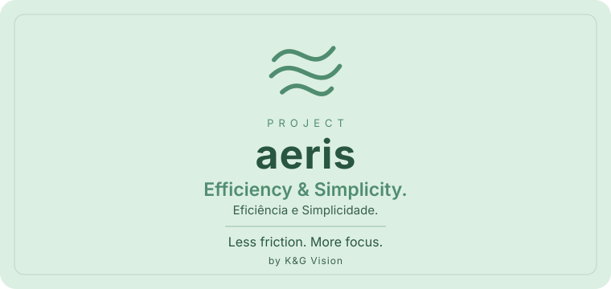

> **Aeris Desktop 1.1.0 RC1 — nova prévia experimental.** Consulte [as releases publicadas](https://github.com/Kgasil/aeris/releases) para verificar se o novo instalador está disponível. A análise independente ClamAV continua pendente. Instalador sem assinatura digital; não ignore alertas, não desative proteções e use apenas ambiente de testes com dados fictícios. A prévia RC5 anterior continua disponível. [Validação da nova compilação](https://github.com/Kgasil/aeris/actions/runs/45893869745).

> **Aeris Desktop RC5 — prévia pública experimental gratuita.** [Download, avisos e SHA-256](https://github.com/Kgasil/aeris/releases/tag/aeris-desktop-1.0.0rc5-terms1-preview). Instalador x64 12,80 MB, sem Python externo, conta ou terminal. Microsoft Defender: nenhuma ameaça detectada em análise diagnóstica em 26/11/2026. Sem assinatura digital; Windows cliente e revisão dos termos de terceiros pendentes. Use apenas ambiente descartável e dados fictícios, analise com proteção atualizada e não contorne bloqueios. Não é versão estável.

# Project Aeris — Eficiência e Simplicidade.

<!-- kg-personal-portfolio-v1 -->

**Idealizador / Creator:** [Kaio Gabriel da Silva — KG Professional Portfolio 1.0](https://kgasil.github.io/portfolio/) · [GitHub](https://github.com/Kgasil) · [LinkedIn](https://www.linkedin.com/in/kaio-gabriel-da-silva). Portfólio pessoal independente do projeto / Personal portfolio separate from this project.

<!-- kg-current-training -->
**Formação e trajetória do idealizador / Creator's education and experience:** [Currículo público atualizado / Updated public résumé](https://kgasil.github.io/portfolio/resume.html) · [Portfólio / Portfolio](https://kgasil.github.io/portfolio/). A formação pessoal é independente dos produtos e materiais do projeto / Personal training is independent of project products and materials.

**Efficiency & Simplicity. · Eficiência e Simplicidade.**  
*Less friction. More focus.*  
Light · Modular · Privacy-conscious  
*by K&G Vision*

[Website](https://kgasil.github.io/aeris/) · [Português](#português) · [English](#english)

> **Marco 1.0 — Aeris Extension 1.0.0.** 16 ferramentas, 50 testes automatizados aprovados, instalação manual gratuita via GitHub. Desktop RC1 em prévia pública de código-fonte; 50 ferramentas refinadas, fonte RC5 consolidada e novo candidato experimental aprovado em CI (477 testes distintos e 60 smokes). [Baixar extensão / Download extension](https://github.com/Kgasil/aeris/raw/refs/heads/main/downloads/Aeris-Extension-v1.0.0-install.zip) · [Tutorial](https://github.com/Kgasil/aeris/tree/main/extension).

**Papel no ecossistema / Ecosystem role:** No ecossistema K&G Vision, o Aeris busca tornar tarefas recorrentes mais simples, aproximando ferramentas tecnológicas do cotidiano. / Within the K&G Vision ecosystem, Aeris aims to simplify recurring tasks and make technology more accessible in everyday work.

## Português

### Instalação simples — Desktop Windows x64

[**Acessar downloads do Aeris**](https://kgasil.github.io/aeris/#instalacao) · [Compilações de teste](https://github.com/Kgasil/aeris/actions/workflows/aeris-integrated-candidate.yml) · [Checklist de lançamento](validation/desktop-release-checklist.md)

O instalador experimental Setup.exe já passou por instalação, reinstalação e desinstalação no Windows Server 2022. Ele inclui o runtime: não exige Python ou terminal. Os artefatos de CI são evidências experimentais, não instaladores aprovados para uso público. Não executar antes da revisão de segurança. O novo instalador simplificado passou em CI; a publicação permanente exige revisão de licenças/redistribuição e confiança vinculada ao artefato exato. O site exibirá o botão direto assim que a prévia for publicada. Sem assinatura digital; use dados fictícios. Windows 10/11 e versão estável ainda pendentes.

O Aeris é um projeto da K&G Vision para criar ferramentas leves, discretas e úteis ao cotidiano. A proposta reúne um aplicativo desktop para Windows e uma extensão para navegadores Chromium, com módulos opcionais e processamento local sempre que possível.

**Situação atual: extensão 1.0.0 disponível para instalação manual; Desktop RC1 em prévia pública de código-fonte, RC4 histórico validado em CI e RC5 experimental aprovado em CI.** As 50 ferramentas desktop receberam refinamentos e os 54 arquivos modificados foram verificados. O website oferece seis demonstrações interativas; a branch `develop` ainda contém a versão inicial 0.1.0a4. O pacote completo está disponível abaixo; o instalador final permanece pendente.

[Experimente no navegador](https://kgasil.github.io/aeris/demo.html) · [Instalação e downloads](https://kgasil.github.io/aeris/#instalacao)

Edição única gratuita, incluindo o AI Companion opcional (Ollama instalado separadamente).

### Catálogo de protótipos

| Categoria | Ferramentas previstas |
| --- | --- |
| Core | Hub, Spotlight, Health, Backup, Bridge |
| Productivity | Focus, Workspace, Checklist, Reminder, Routine |
| Memory | Vault, Capture, Timeline, Ideas, Bookmarks |
| Quick Actions | Autofill, Clipboard, Snippets, Expand, Convert |
| Communication | Translate, Voice, Text, Email, Meeting |
| Learning | Learn, Research, Flashcards, Pronounce, Accessibility |
| Intelligence | Copilot, Context, Interview, Search, Debug |
| Business | Data, Dashboard, Report, Calculator, Decision |
| Files | Documents, Organizer, Drop, Compare, Lens |
| Security | Privacy, Link, Verify, Permissions, Metadata |

50 ferramentas refinadas; fase Security: 473/477 testes Windows e 54 smokes, com quatro skips e ocorrência de limpeza Tk em revisão. RC5: 362 arquivos de fonte consolidados com hashes verificados; pacote experimental aprovado em CI, com 477 testes distintos e 60 smokes; avisos Tk não reapareceram na revalidação. Windows 10/11 cliente pendente. [Estado da versão candidata](https://kgasil.github.io/aeris/release-status.html).

### Princípios de desenvolvimento

- Carregamento sob demanda, baixo consumo de recursos e módulos opcionais.
- Processamento local quando viável, permissões explícitas e proteção de informações.
- Nenhuma captura de áudio, tela ou informação sensível sem autorização.
- Funcionalidades locais inicialmente gratuitas, sem anúncios ou conta obrigatória, como objetivo de projeto.
- Validação contínua; a extensão 1.0.0 está disponível para instalação manual, sem alegação de desempenho certificado.

## English

[**Aeris Desktop downloads**](https://kgasil.github.io/aeris/#instalacao) · [Test builds](https://github.com/Kgasil/aeris/actions/workflows/aeris-integrated-candidate.yml) · [Release checklist](validation/desktop-release-checklist.md). The experimental Setup.exe bundles the runtime; no Python or terminal required. CI artifacts are experimental evidence, not approved public installers; do not execute before security review. A permanent direct executable download is gated on documented redistribution and trust review; the website reveals the direct link only when the preview asset is published. Unsigned preview; use synthetic data only. Windows 10/11 and stable release remain pending.

Aeris is designed around one principle: technology should work for you, not interrupt you. Our lightweight Windows desktop prototype and manually distributed Chromium extension aim to make everyday productivity feel effortless with optional modules, on-demand execution, local-first processing where feasible and explicit permissions.

The catalog comprises 50 desktop prototypes built locally. The site includes six simplified interactive demos. The published develop branch still contains the early 0.1.0a4 source; the complete source ZIP is now published; the final installer is pending.

One free edition, including optional AI, with no ads or mandatory Aeris account, is the project policy. Performance, security, compatibility and licensing must be evaluated before any preview release.

## Repository

- `index.html` — responsive bilingual concept website.
- `assets/aeris-symbol.svg` — Aeris wind symbol.
- `assets/brand-banner.svg` — brand banner.

Open `index.html` in a browser. No build step or backend is needed. The website uses GitHub Pages from `main` at `/ (root)`. The early desktop source is in `develop`; `demo.html` and `assets/web-lab.js` power the browser lab.

## GRAAL — Ecosystem / Ecossistema · Marco 01

| Project | Website | Repository | Current stage / Etapa atual |
| --- | --- | --- | --- |
| K&G Vision | [Institutional](https://kgasil.github.io/) | [Source](https://github.com/Kgasil/kgasil.github.io) | Independent initiative / Iniciativa independente |
| Project Genesis | [Wisdom & Application / Sabedoria e Aplicação](https://kgasil.github.io/genesis/) | [Source](https://github.com/Kgasil/genesis) | **1.0 — Editorial & Library / Acervo e biblioteca.** 75 private study PDFs; [public interactive library](https://kgasil.github.io/genesis/biblioteca.html) / 75 PDFs privados; biblioteca pública interativa, sem cursos ou certificados. · [Genesis Mini — complemento gratuito](https://kgasil.github.io/genesis/mini/) · [Instalar extensão / Install extension](https://kgasil.github.io/genesis/#instalar-extensao) |
| Project Rubedo | [Science & Innovation / Ciência e Inovação](https://kgasil.github.io/rubedo/) | [Source](https://github.com/Kgasil/rubedo) | **Marco 01 — Public Lab 1.0.** [Research Workspace 1.0](https://kgasil.github.io/rubedo/research/) · [Mini Lab 1.0.0](https://kgasil.github.io/rubedo/mini/) · [Instalação manual / Manual installation](https://kgasil.github.io/rubedo/#instalar); experimental, no store distribution. |
| Project Argus | [Security & Development / Segurança e Desenvolvimento](https://kgasil.github.io/argus/) | [Source](https://github.com/Kgasil/argus) | **1.0 — Public Research Lab / Laboratório público.** Technical baseline V10.2; local demonstrations / Base técnica V10.2; demonstrações locais, não serviços de produção. [Argus Mini — amostra complementar / complementary sample](https://kgasil.github.io/argus/mini/), v0.1.0; original milestone unchanged / marco original preservado. · [Instalar extensão / Install extension](https://kgasil.github.io/argus/#instalar-extensao) |
| Project Aeris | [Efficiency & Simplicity / Eficiência e Simplicidade](https://kgasil.github.io/aeris/) | [Source](https://github.com/Kgasil/aeris) | **1.0 — Extension 1.0.0.** [Manual installation / Instalação manual](https://github.com/Kgasil/aeris/tree/main/extension); Desktop RC5 experimental aprovado em CI, 50 ferramentas refinadas; fonte pública RC1, lançamento estável adiado / RC5 experimental CI passed, 50 tools refined; public source RC1, stable release deferred. |
| Project Lilium | [Strategy & Growth / Estratégia e Crescimento](https://kgasil.github.io/lilium/) | [Source](https://github.com/Kgasil/lilium) | **1.0 — Web Lab.** Public demo / demonstração pública; Desktop v0.14.0 controlled preview / prévia controlada; [Mini v0.1.1](https://github.com/Kgasil/lilium/tree/main/extension) experimental. |

**Version note / Nota de versão:** 1.0 identifies the first completed public-facing project milestone of the ecosystem, not a uniform software release tag. Genesis is an editorial milestone; Argus retains technical baseline V10.2; Aeris 1.0.0 applies to Extension; Lilium 1.0 applies to Web Lab. / 1.0 identifica o primeiro marco público do ecossistema, não uma tag de software uniforme. Genesis é um marco editorial; Argus mantém a base V10.2; Aeris 1.0.0 refere-se à extensão; Lilium 1.0 refere-se ao Web Lab. Desktop previews are not stable releases / Prévias Desktop não são versões estáveis.

**Learn · Discover · Build · Simplify · Transform / Aprender · Descobrir · Construir · Simplificar · Transformar**

License terms are not yet specified. Public visibility does not grant permission to redistribute code or assets.

## Identidade K&G Vision / K&G Vision identity

[Versão vertical / Vertical lockup](https://github.com/Kgasil/kgasil.github.io/blob/main/assets/brand-stacked.svg) · [Escudo / Shield](https://github.com/Kgasil/kgasil.github.io/blob/main/assets/kg-symbol.svg)

Official visual lockup: **K&G** above **Vision**; individual project symbols are retained. / Assinatura visual oficial: **K&G** acima de **Vision**, mantendo os símbolos individuais dos projetos.

**Genesis (purple) · Rubedo (orange/gold) · Argus (blue) · Aeris (green) · Lilium (rose)**

O escudo institucional preserva as quatro cores laterais e o núcleo branco; Rubedo ocupa apenas as pontas centrais superior (laranja) e inferior (dourado). / The institutional shield preserves its four side colors and white core; Rubedo occupies only the upper (orange) and lower (gold) central tips.

[Lilium Interactive Lab / Laboratório interativo](https://kgasil.github.io/lilium/#lab) · [Insights CSV demo](https://kgasil.github.io/lilium/demo.html) — browser-based synthetic exercises; no connected AI or commercial offering.

**Lilium Mini v0.1.1 — GitHub-only / exclusivamente pelo GitHub:** [Installation tutorial / Tutorial de instalação](https://github.com/Kgasil/lilium/tree/main/extension) · Chrome & Edge, manual installation with synthetic data / instalação manual com dados fictícios. Not published in extension stores / não publicado nas lojas.

**25 NOV 2026 — Lilium Web Lab 1.0:** [Comunicado / Announcement](https://github.com/Kgasil/lilium/blob/main/docs/web-lab-v1.0.md) · Public browser demonstrations / Demonstrações públicas no navegador. Desktop v0.14.0 remains a controlled preview / continua em prévia controlada.

## Release preparation / Preparação de lançamento — 1.0.0rc1

The local source candidate has 50 tools. 393 unit tests and 60 graphical scripts passed on Linux; six Windows-only tests were skipped in Linux. No stable Windows installer has been released, and the complete source package is now available in `downloads/`. The public Web Lab and complete source ZIP are available. The browser extension has its own 1.0.0 manual distribution, separate from this Desktop release candidate.

[Release status / Estado da versão](https://kgasil.github.io/aeris/release-status.html)

### Download do candidato / Source candidate download

- [ZIP completo / Complete ZIP](https://github.com/Kgasil/aeris/releases/download/v1.0.0rc1/Aeris-1.0.0rc1-source.zip)
- [SHA-256](https://github.com/Kgasil/aeris/releases/download/v1.0.0rc1/SHA256SUMS.txt)

Windows: Python 3.12 or 3.13 with Tcl/Tk, extract ZIP, open `desktop`, run `py -3 main.py`. See included `distribution/build.ps1` for build instructions. Test with dummy data; native Windows validation is not yet approved.

### Windows compatibility fix 1

The recommended source download now includes the Windows compatibility corrections directly. The first native CI run had 8 failures, 24 errors and 4 skips; the second stopped at patch-file SHA-256 verification before testing. A third run uses the corrected ZIP itself, avoiding checkout newline conversion. See [Windows Actions](https://github.com/Kgasil/aeris/actions). The package is still experimental, not a validated installer.

### Windows CI — regression test compatibility

The third run reached 394 passed, four skipped and one error (399 total). Windows denied replacement of an open file. The next CI run overlays `validation/test_verify.py` onto the verified Fix 1 archive, preserving security assertions and independently testing a completed replacement. Application code and published source ZIP remain unchanged. Local Linux regression: 393 passed, six skipped.

### Windows CI — packaging fix 2

The [fourth run](https://github.com/Kgasil/aeris/actions/runs/45729575816) passed 395 unit tests, with four skips and no errors or failures. PyInstaller could not locate the catalog because the source path was relative to the generated spec directory. The workflow now applies a checked, build-only absolute-path adjustment. The historical Fix 1 ZIP is unchanged; the executable and installer remain unapproved. Linux regression on the local corrected source: 393 passing tests, six skips.

### Portable Windows preview — successful CI

[Run 45730089078](https://github.com/Kgasil/aeris/actions/runs/45730089078) passed 395 native unit tests (four skips), PyInstaller build, packaged UI self-test, and 1,002-file portable bundle verification on Windows Server 2022. The unsigned temporary artifact is available on the run page until December 3, 2026. This is not Windows 10/11 certification or a stable release. A separate installer-preview workflow checks build, install, same-version reinstall and uninstall with synthetic data on a disposable runner.

### Windows installer preview — successful CI

[Run 45730507059](https://github.com/Kgasil/aeris/actions/runs/45730507059) successfully built the experimental unsigned Setup.exe and passed installation, same-version reinstallation, uninstall, packaged UI self-tests, and synthetic-data preservation on Windows Server 2022. Downloaded artifacts were hash-verified. [Temporary installer and portable ZIP](https://github.com/Kgasil/aeris/actions/runs/45730507059/artifacts/15076935274) (expires December 3, 2026; GitHub login may be required). [Evidence and SHA-256 values](downloads/windows-preview-evidence.json). Not a stable release; Windows 10/11, actual AI/audio/OCR, performance, upgrade across versions and licensing remain pending.

## Primeira prévia pública / First public preview

**25/11/2026 · v1.0.0rc1.** [Notas de lançamento](release/rc1-notes.md) · [GitHub Releases](https://github.com/Kgasil/aeris/releases/tag/v1.0.0rc1). Public source preview; experimental binaries remain temporary CI artifacts. Stable binary distribution is blocked pending validation and licensing review. The build workflow now validates only; publication will require a separate exact-artifact approval process, without rebuilding after review.

## Aeris Extension — 1.0.0

16 ferramentas na extensão Manifest V3. 50 testes Node aprovados; sintaxe JavaScript, hashes e reconstrução determinística conferidos. A versão 1.0.0 preserva a lógica RC2 testada pelo responsável. / 16 tools, 50 passing Node tests, verified syntax, checksums and reproducible install package. Version 1.0.0 preserves the RC2 logic. ZIPs disponíveis no GitHub; validação nativa independente e publicação em lojas pendentes. / ZIPs available on GitHub; independent native browser validation and store publication pending. [Instruções / Instructions](https://kgasil.github.io/aeris/extension-preview.html) · [Laboratório de validação / Validation lab](https://kgasil.github.io/aeris/extension-validation.html).

### Instalação manual / Manual installation

[**Baixar extensão / Download extension**](https://github.com/Kgasil/aeris/raw/refs/heads/main/downloads/Aeris-Extension-v1.0.0-install.zip) · [Código-fonte completo / Full source](https://github.com/Kgasil/aeris/raw/refs/heads/main/downloads/Aeris-Extension-v1.0.0-completa.zip)

[**Tutorial completo: Chrome, Edge e Opera**](extension/README.md) · [Notas 1.0.0](release/extension-1.0.0-notes.md) · [SHA-256](downloads/Aeris-Extension-v1.0.0-SHA256SUMS.txt)

1. Extraia o ZIP de instalação em uma pasta permanente.
2. Abra `chrome://extensions/`, `edge://extensions/` ou `opera://extensions/`.
3. Ative o modo de desenvolvedor e selecione Carregar sem compactação, se permitido.
4. Escolha a pasta com `manifest.json` e abra Aeris no menu de extensões.

ZIPs publicados no GitHub. Não publicado nas lojas. / ZIPs published on GitHub. Not published in extension stores.

 **GRAAL · Marco 01** — identidade integrada / integrated identity.

**GRAAL — Descobrir / Discover:** [Rubedo Research Workspace](https://kgasil.github.io/rubedo/research/) · [Precisão / Precision (R06)](https://kgasil.github.io/rubedo/research/#precisao) · [Monte Carlo (R07)](https://kgasil.github.io/rubedo/research/#monte-carlo). Novos modelos experimentais; validação atual pendente / Experimental additions; current validation pending.

**Rubedo — edição 1.0 / 1.0 edition:** [Research Workspace 1.0](https://kgasil.github.io/rubedo/research/) · [Mini Lab 1.0.0](https://kgasil.github.io/rubedo/mini/) · [Mini Extension 1.0.0 — instalação manual / manual installation](https://kgasil.github.io/rubedo/#instalar). Edição experimental / Experimental edition.

### Simplified installer — successful CI (26/11/2026)

[Run 45844861678](https://github.com/Kgasil/aeris/actions/runs/45844861678) passed 395 native unit tests (four skipped), packaging, install/reinstall/uninstall, shortcut checks and synthetic-data preservation. [Temporary test artifact](https://github.com/Kgasil/aeris/actions/runs/45844861678/artifacts/15130517282) expires December 26, 2026. [Verified hashes and evidence](downloads/windows-simplified-preview-evidence.json). Unsigned, synthetic data only; permanent publication remains gated on licensing and trust review. Windows 10/11 interactive validation pending.

## Desktop RC3 — revisão integrada / Integrated review (26/11/2026)

[CI RC3](https://github.com/Kgasil/aeris/actions/runs/45851387942) · [Evidências e hashes / Evidence and hashes](downloads/windows-integrated-rc3-evidence.json) · [Preparação do lançamento / Release preparation](release/desktop-1.0.0-preparation.md).

409 de 413 testes aprovados, quatro ignorados com motivos registrados; instalação, reinstalação, desinstalação e 91 hashes verificados em Windows Server 2022. RC3 não é release pública nem 1.0.0 estável. Windows 10/11, direitos, scan real e decisão de assinatura pendentes. / 409 of 413 tests passed, four documented skips; install, reinstall, uninstall and 91 hashes verified. RC3 is not a public or stable release. Client Windows, redistribution, malware scan and signing decision pending.

## Desktop RC4 — candidato reduzido / Reduced-runtime candidate

[Build RC4](https://github.com/Kgasil/aeris/actions/runs/45853309017) · [Evidências / Evidence](downloads/windows-rc4-reduced-runtime-evidence.json) · [Migração / Migration](validation/installer/UPGRADE-RECOVERY.md).

27 binários, 47 hashes, 409 testes Windows aprovados, quatro skips. RC3→RC4 preservou dados fictícios em CI, mas deixou 44 DLLs antigas; reinstalação limpa removeu-as. **RC4 experimental, não aprovado para distribuição.** Não instalar antes da análise de segurança e validação cliente. / 27 binaries, 47 verified hashes, 409 Windows tests passed, four skips. In-place upgrade retained 44 obsolete DLLs; clean reinstall removed them while preserving synthetic data. Experimental, not approved for distribution. Stable release pending.

### Distribuição sem custos / Zero-cost distribution

[Plano sem custos / Zero-cost plan](release/zero-cost-plan.md). GitHub, GitHub Pages, demonstrações web e instalação manual da extensão. Sem publicação em lojas ou assinatura digital paga; Desktop RC4 experimental, lançamento estável adiado até direitos, segurança e validações aplicáveis. / No paid store publication or paid signing; RC4 remains experimental, stable release deferred pending rights, security and applicable validation.

## RC5 — integração funcional / Functional integration (26 NOV 2026)

**50 ferramentas refinadas / 50 tools refined.** 10 categorias, 64 novas regressões; 473/477 testes Windows e 54 smokes na fase Security. Quatro skips e dois avisos Tk de limpeza de objetos em revisão. A fonte consolidada RC5 tem 362 arquivos, todos com SHA-256 verificado independentemente, incluindo os 54 arquivos refinados idênticos à fase Security. Novo build, 60 smokes, revisão estrita de logs Tk, testes complementares Ubuntu e desempenho em [CI 45863779585](https://github.com/Kgasil/aeris/actions/runs/45863779585); concluída com sucesso. RC4 histórico preservado. Nenhuma publicação binária ou certificação Windows cliente.

**English:** Complete RC5 source snapshot verified (362 files, 54 byte-identical refined files); 50-tool review implemented. Security source CI passed 473/477 tests and 54 smokes, with 4 environment skips and two Tk cleanup warnings to investigate. RC5 packaging, 477 distinct tests, 60 graphical smokes and strict Tk log checks passed CI. No paid services, no new public installer, no stable release claim.

[Roadmap funcional / Functional roadmap](validation/functional/ROADMAP.md) · [Fonte consolidada: evidências / Consolidated source evidence](downloads/functional-rc5-source-evidence.json) · [Workflow permanente / Permanent build recipe](.github/workflows/aeris-functional-integrated-candidate.yml). GitHub Actions artifacts expire; the reconstruction recipe uses versioned inputs and verified hashes, not expired artifacts. / Artefatos temporários expiram; a receita usa arquivos versionados.

**Resultado RC5 / RC5 result:** [Código-fonte consolidado permanente / Permanent consolidated source](https://github.com/Kgasil/aeris/tree/desktop-rc5-source) · [Evidência do pacote / Integrated evidence](downloads/functional-rc5-integrated-evidence.json). 477 testes distintos aprovados (473 Windows Server + 4 Ubuntu), 60 smokes; Setup experimental de 12,79 MB, 47 hashes verificados, 27 binários, 17 avisos. Sem assinatura, Windows cliente e distribuição não aprovados. Revisões exatas de [migração](https://github.com/Kgasil/aeris/actions/runs/45864700604) e [antimalware](https://github.com/Kgasil/aeris/actions/runs/45864693947) separadas. / Experimental setup only; no client certification or distribution approval.

**Revisão adicional RC5 (26/11/2026):** atualização RC4→RC5, reinstalação limpa, rollback e restauração de cópia PASS no Server 2022; oito manifestos idênticos, zero DLLs obsoletas. ClamAV 1.5.4, daily 28194: integridade e assinatura da base PASS, idade 124.817 s (>24 h), scan NOT_TESTED. Defender em tempo real inativo na CI. Não publicar instalador antes da revisão aplicável. [Evidência exata](https://github.com/Kgasil/aeris/blob/main/downloads/functional-rc5-integrated-evidence.json).

## Disponibilização experimental (26/11/2026)

A pedido explícito do titular, a revisão terms1 foi disponibilizada publicamente para testes. [CI de publicação](https://github.com/Kgasil/aeris/actions/runs/45866976810) confirmou download anônimo e SHA-256. O executável é idêntico ao RC5; somente o instalador recebeu aceite dos termos. Os avisos de revisão pendente permanecem aplicáveis. Sem aprovação estável ou alegação de segurança.

**Defender (26/11/2026):** instalador público exato, ZIP portátil e 47 arquivos do manifesto extraído verificados; nenhuma ameaça detectada. Controle EICAR detectado corretamente, definições 1.463.481.0 atualizadas, hashes pós-scan conferidos. Análise personalizada diagnóstica em Windows Server 2022 CI, sem proteção em tempo real no runner, sem execução do Aeris ou mudança de políticas. [Evidências](downloads/rc5-defender-diagnostic-evidence.json) · [CI](https://github.com/Kgasil/aeris/actions/runs/45867805450). Resultado pontual, não certificação ou garantia de segurança; SmartScreen pode alertar por ausência de assinatura.
